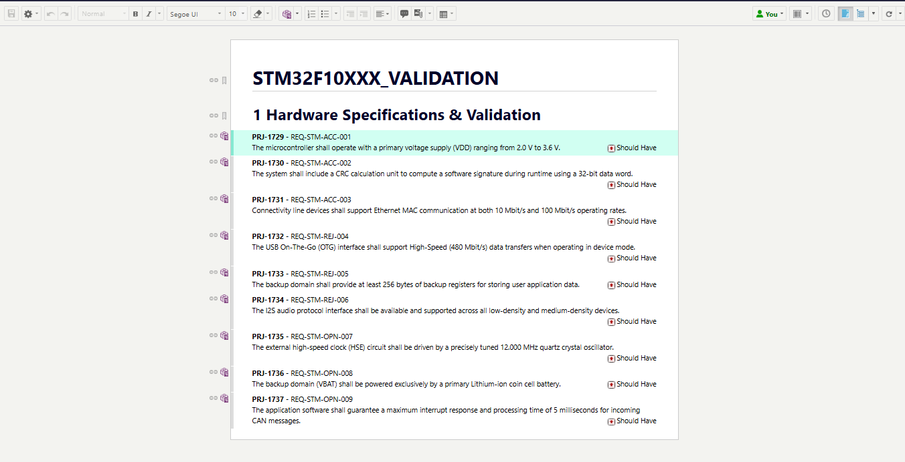
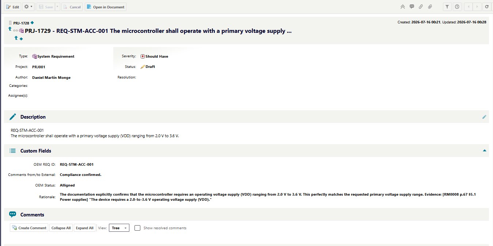

# CTSM · Customer-to-Supplier Mapping

*Read this in [English](README.md).*

Audita los requisitos de una especificación de cliente (un ReqIF exportado de Polarion) contra la documentación del proveedor (PDF), y devuelve **el mismo fichero ReqIF** con, por cada requisito, la evidencia encontrada y su página exacta. El modelo nunca escribe una ubicación. El fichero de entrada nunca se regenera. Funciona sin red.

> La IA tiene riesgos. El código los acota. La norma responde de lo que queda.

[Probarlo](#probarlo) · [Filosofía de diseño](#filosofía-de-diseño) · [Dónde aporta valor la IA](#dónde-aporta-valor-la-ia) · [Los cinco pasos](#los-cinco-pasos-en-este-proyecto) · [Medido](#medido) · [Limitaciones](#limitaciones) · [Seguridad y regulación](#seguridad-y-regulación)

---

## Probarlo

### Una ejecución grabada: sin modelo, sin GPU, menos de un minuto de instalación

```bash
pip install -r requirements.txt
python ui/app.py --demo                           # → http://127.0.0.1:8078
```

Es la interfaz del propio programa reproduciendo una ejecución real en vez de calcularla: qwen2.5:14b auditando los nueve requisitos contra las 1.136 páginas del manual RM0008 en una RTX 2060, grabada el 2026-10-27 (`ui/demo/stm32/`) y reproducida a ×12. La pantalla lo dice. Veredictos y citas se copian del log de esa ejecución con `ui/grabar_demo.py`, sin editar.

- **Qué puedes hacer:** ver correr los cinco pasos, abrir cada requisito con su veredicto, su cita verificada y su página, ver el libro de custodia (llamadas al modelo, quién las lanzó, datos que salieron de la máquina: cero) y la cita que el código rechazó (4–16 MHz frente a 3–25). Si RM0008 está en `data/inputs/supplier_docs/`, cada cita se ve resaltada en su página del manual.
- **Qué no puedes hacer:** subir tu propio ReqIF o tus PDFs, cambiar de modelo ni descargar un ReqIF de salida. No se calcula nada, así que no hace falta GPU, ni modelo, ni red.

Por qué una grabación: una ejecución en vivo necesita Ollama con un modelo de 9 GB y tarda unos 20 minutos en una GPU de 6 GB (150 s por requisito). La grabación deja ver el flujo entero en un par de minutos, sin fingir que se está calculando.

### El programa completo

`python ui/app.py`, sin `--demo`, es el programa entero (necesita Ollama con `qwen2.5:7b` o `qwen2.5:14b`, y `CUSTODIA_ACTOR`, como `run.py`). Recibe tu ReqIF y los PDFs del proveedor, ejecuta el mismo pipeline en un sandbox por trabajo, enseña cada veredicto según lo escribe `s4` y te da el ReqIF de salida y los tres candados de `roundtrip_diff`. La versión por línea de comandos está en [El pipeline completo sobre datos públicos](#el-pipeline-completo-sobre-datos-públicos).

---

## Filosofía de diseño

Cualquier aplicación con IA tiene cinco pasos. Solo el paso 4 invoca un modelo; los otros cuatro son código: reproducibles, testeables, sin red. El paso 5 nunca corrige: marca y degrada. Texto completo en [epifaneia.dev](https://epifaneia.dev).

```
 1 LIMPIEZA      2 CONTEXTO      3 GUARDARRAÍL IN    4 PROCESO        5 GUARDARRAÍL OUT
 ■ código        ■ código        ■ código            ▲ modelo         ■ código
```

## Dónde aporta valor la IA

Una especificación de cliente tiene decenas de requisitos; el manual del proveedor que los responde tiene mil páginas. Cruzar lo uno con lo otro es leer y juzgar, y una herramienta convencional se ahoga: una búsqueda por palabras sobre un export de Polarion de miles de líneas XML y un manual de 1.136 páginas devuelve ruido, y una persona a mano tarda días por documento. El modelo hace lo único que solo un modelo puede hacer, leer un requisito y encontrar el pasaje que lo responde, y el código hace todo lo demás: dónde está el pasaje, si la cita es real, y que el fichero que recibe el cliente es el mismo que envió.

---

## Los cinco pasos en este proyecto

★ marca dónde está la mejora en este proyecto: el **contexto** y el **guardarraíl de salida**.

| Paso | Qué hace aquí | |
|---|---|---|
| 1 · Limpieza | `s0` añade al ReqIF los tres campos objetivo si el export no los trae (solo esquema, ids deterministas). `s1` parsea ids, jerarquía, campos objetivo y el enum de estado del propio fichero. `s2` convierte los PDF del proveedor en chunks con sección, página y `page_map` por offset (PyMuPDF; PDFs cifrados descifrados en memoria). | |
| 2 · Contexto | `s3` recupera BM25 top-K chunks por requisito, o pasa el corpus entero cuando cabe. Cada chunk lleva id, página y sección: el modelo podrá señalar, nunca describir. `utils/citables` trocea cada chunk en unidades numeradas para que una cita se elija por índice. | ★ |
| 3 · Guardarraíl de entrada | `s4` llama con un schema de respuesta forzado: `status` restringido al enum que declara el fichero, `chunk_id` restringido, por requisito, a los candidatos de ese requisito. Citar una ubicación no dada es estructuralmente imposible. | |
| 4 · Proceso | Una llamada por requisito, sin lotes. Backend `ollama` (local, por defecto) o `gemini` (nube), mismo contrato. Tres modos (`run.py --modo`): **veredicto** (por defecto), `s4` decide el estado y cita; **revision**, después `s5_review` juzga cada pasaje candidato (apoya, contradice, irrelevante) con un modelo pequeño, y el grande arbitra donde discrepan; **evidencia**, sin ninguna llamada a modelo: `s4_evidence` ancla los pasajes a su página y deja el estado abierto para que decida el ingeniero. | |
| 5 · Guardarraíl de salida | `s6` busca cada cita **literal** en el chunk que el modelo señaló, tras normalizar el ruido del PDF (guiones de partición, saltos de línea, comillas tipográficas), y deriva la página exacta del offset del match. Un match literal tiene que empezar y acabar en límite de palabra («200 mA» no está dentro de «1200 mA», ni «40 °C» dentro de «-40 °C») y no puede dejar fuera un «not» justo delante. Una cita que solo se parece (similitud ≥ 0,85) se acepta solo si conserva cada cifra del pasaje en orden, con su signo y su unidad, cada negación y una lista corta de opuestos como máximo/mínimo; entonces se sustituye por las palabras del propio manual y se marca. Una paráfrasis que cambia un número o un «no» no cuenta como evidencia. Lo que el fichero enseña como cita es siempre texto del manual, nunca del modelo. Un veredicto apoyado solo en paráfrasis se mantiene, pero marcado para revisarlo antes de firmar. Un veredicto que se queda sin evidencia verificada se degrada al valor abierto, con flag. En modo revision, un solo pasaje que contradiga basta para un "no". `s7` edita el original con lxml y `roundtrip_diff` demuestra que nada más cambió: `tests/test_roundtrip.py` le lanza diez sabotajes y detecta los diez. | ★ |

### Qué escribe, y dónde

| Campo del ReqIF de cliente | Qué se escribe |
|---|---|
| `Status` (enumeración) | El veredicto, por `ENUM-VALUE-REF` a un valor que el fichero ya declara. Jamás texto libre. |
| `Rationale` (XHTML) | El análisis más las citas ancladas: `[RM0008 p.81 §6.1] "quote..."`. |
| `Comments from/to External` (XHTML) | Mensaje corto al cliente: confirmación, deviation request o pregunta. |

## Medido

Set: 9 requisitos escritos contra el manual de referencia STM32F10xxx RM0008 (1.136 páginas, documento público de ST), con ground truth construido a mano. Máquina: RTX 2060 (6 GB de VRAM), 16 GB de RAM, Ryzen 5 3500X; el 14B no cabe entero en la gráfica y corre repartido entre GPU y CPU.

| Motor | Aciertos vs ground truth | Falsos "cumple" | Segundos / requisito |
|---|---|---|---|
| **qwen2.5:14b, local** | **9 / 9** | **0** | 150 (autofit de Ollama) |
| qwen2.5:7b, local | 8 / 9 (7 / 9 en una segunda pasada) | 0 | 25–29 |
| gemini (nube) | sin volver a medir | | |

Medido el 27-10-2026 y repetido el 29-10-2026 guardando cada salida: el log, los veredictos en bruto, los resultados sellados y la puntuación de cada pasada están en [`mediciones/2026-10-29/`](mediciones/2026-10-29/). La repetición dio los mismos aciertos; los segundos salen de ella. n = 9: un set pequeño, léelo como prueba de humo, no como benchmark. Las pasadas no son idénticas: en su segunda pasada el 7B perdió REQ-STM-002, un *Compliant* que `s6` degradó a *Unconfirmed* porque su cita no estaba en el pasaje que señalaba. Una versión anterior de esta tabla usaba identificadores que insinuaban la respuesta esperada (`REQ-STM-ACC-001`, `-REJ-`, `-OPN-`), y el identificador llega al prompt. Ahora son neutros y van mezclados, y los dos modelos locales se han vuelto a medir; los dos han salido mejor que antes. La fila de nube no se ha vuelto a correr.

De esa tabla salen dos cosas. El modelo local elimina la salida del dato, y la tarea acotada es lo que hace que un 14B baste. Lo que un modelo falla, el guardarraíl lo marca en vez de colarlo: el fallo del 7B es un *Not compliant* donde se esperaba *Unconfirmed*, marcado por `s6` porque una de sus dos citas no verificó; ningún modelo dio un falso *Compliant*.

Lo que caza la comprobación literal, en esta misma ejecución. En REQ-STM-001 el 14B citó *"The **4 to 16 MHz** external oscillator has the advantage of producing a very accurate rate on the main clock"*; el pasaje que señaló dice ***3 to 25 MHz***. Un umbral de similitud solo lo da por bueno (0,96). `s6` ve que las cifras no coinciden, descarta esa cita como evidencia y deja anotado por qué: `cifras distintas: modelo 4 16 / manual 3 25`. De las 16 citas de la ejecución, 12 son literales, 3 son paráfrasis que conservan todas las cifras (mostradas con el texto del manual) y 1 es esta, descartada. Los veredictos no cambian: 9/9.

`tools/score_vs_fixture.py` reproduce la tabla. Calibra los hilos de Ollama con el prompt **más largo** del set, no con el más corto: con un prompt corto un ajuste parece más rápido de lo que es con requisitos reales.

Además del set público, el pipeline se ha corrido sobre una especificación real de cliente (53 requisitos) y los manuales de su proveedor. Esos datos no están en este repositorio; las capturas de abajo son del set público.

## Polarion

Datos públicos en un Polarion de prueba: los nueve requisitos de STM32 contra el RM0008. Nada que tachar.

*El documento de demo tras el import: una cabecera, nueve requisitos, cada uno con su identificador verbatim como título.*



*El mismo requisito después de que el pipeline escribiera en el fichero: el enum de estado puesto, el rationale con la cita, y la página y la sección derivadas por código del manual del proveedor.*



*El mapeo de importación ReqIF en Polarion: los campos del pipeline se mapean a los del proyecto; en el lado de Polarion no se crea nada.*


## El pipeline completo sobre datos públicos

```bash
pip install -r requirements.txt
ollama pull qwen2.5:7b                            # con `ollama serve` corriendo en otra terminal
export CUSTODIA_ACTOR=demo                        # el pipeline no corre de forma anónima

# 1. un ReqIF de partida desde el fixture, clonando el esquema de cualquier ReqIF exportado de tu Polarion
CTSM_STK_TEMPLATE=ruta/a/cualquier_export.reqif python tools/build_demo_stk.py
# 2. deja RM0008 (st.com, manual de referencia STM32F10xxx) en data/inputs/supplier_docs/
python run.py STM32                               # s0 → s7 sobre el fichero de demo (s2: 1.136 páginas en ~2 s)
python tools/score_vs_fixture.py STM32 tools/fixtures/stm32_validation_9reqs.json
```

`s7` ejecuta él mismo `roundtrip_diff` contra la entrada preparada y falla si cambió algo fuera de los tres campos objetivo.

Este repositorio no lleva datos: ni entradas, ni intermedios, ni salidas. `data/` está fuera de git.

## Limitaciones

- La demo necesita un ReqIF exportado de *tu* Polarion como plantilla de esquema. Los exports cambian por proyecto, así que `build_demo_stk` clona el tuyo por `LONG-NAME` en vez de traer uno.
- `s5_config` (extracción de parámetros de configuración) es un stub retirado del alcance.
- El scoring que `s6` promete en su docstring nunca corre sobre ficheros reales. Usa `tools/score_vs_fixture.py`.
- El import en Polarion de un fichero escrito por el pipeline se ha verificado estructuralmente (roundtrip_diff) y visualmente (capturas); el import en sí es un paso manual.
- Docling queda reservado para documentos escaneados y no está conectado por defecto: descarga modelos en la primera ejecución, y eso rompería el air gap de `s2`.
- Solo se verifican las citas. El análisis y el comentario que vuelven en el ReqIF son palabras del modelo: en REQ-STM-001 el comentario sigue diciendo «4-16 MHz or 3-25 MHz». El veredicto se apoya en citas verificadas; la prosa que lo acompaña, no.
- Identidad, eventos y firma van como contrato con un valor local por defecto (variable de entorno, fichero JSONL, clave HMAC). Los adaptadores al Entra ID, SIEM o PKI de una empresa no están aquí ni se pueden probar aquí: ver [docs/INTEGRATION.es.md](docs/INTEGRATION.es.md).

---

## Seguridad y regulación

Los mismos cuatro epígrafes en todos los repositorios. Las filas **hoy** son lo que hace el código. Las filas **cable** son los tres cables de integración que el repositorio trae como contrato (identidad, eventos, firma) y la empresa conecta a sus sistemas: ver [docs/INTEGRATION.es.md](docs/INTEGRATION.es.md). Pruebas locales, sin red ni modelo: `python tests/todas.py` (los cables de custodia, las citas literales y los diez sabotajes de ida y vuelta).

| | | |
|---|---|---|
| **Confidencialidad** | Local por defecto: Ollama en `127.0.0.1` (qwen2.5:7b por defecto; la ejecución medida usó el 14B), ningún byte sale de la máquina, el pipeline completo funciona con la red desenchufada. La tarea está lo bastante acotada para que un modelo local baste (9/9 con el 14B, 0 falsos "cumple"). El backend de nube es solo para dato no confidencial y comparación: cuando está activo, `s4` imprime en cada ejecución que envía el texto del requisito y hasta 10 chunks del manual (~28.000 caracteres) a Google. Los PDF cifrados se descifran en memoria; no se escribe copia en claro. `data/` y `.env` fuera de git. | **hoy** |
| **Trazabilidad** | Cada veredicto lleva su evidencia con documento, página, sección y ratio de match; la cita la compone el código, nunca el modelo. `results.json` guarda, por requisito, cada cita verificada con su página, si es literal o aproximada (con la versión del modelo aparte) y cada marca del verificador. | **hoy** |
| | **Cable 2 · eventos.** Toda llamada al modelo pasa por `custodia/ledger`: una línea JSON con actor, paso, motor, endpoint, si el dato salió, tamaño y hash. Nunca el texto. `logs/custody.jsonl` o stdout. La empresa apunta su SIEM ahí. | **cable** |
| **Prevención de fugas** | El modelo no tiene credenciales; el paso que lo invoca tiene el endpoint y solo ve los chunks seleccionados para ese requisito. Todo lo demás es código sin acceso a red. | **hoy** |
| | **Cable 1 · identidad.** `run.py` se niega a arrancar sin un actor con nombre (`custodia/identity`, por defecto `CUSTODIA_ACTOR`); el actor se estampa en cada evento y cada firma. La empresa sustituye el proveedor por Entra ID, LDAP, Kerberos o su SSO en una llamada. Los permisos por capa sobre entradas, intermedios, modelo y salidas son los de la empresa, en su sistema de ficheros y su vault. | **cable** |
| **Humano en el bucle** | Todo requisito sin evidencia verificada se queda en el valor abierto con un flag; el revisor mira lo marcado, no todo. En modo evidencia el sistema nunca dictamina: ancla la evidencia a su página y decide el ingeniero. | **hoy** |
| | **Cable 3 · firma.** Una salida es una propuesta hasta que `tools/signoff.py sign` escribe su manifiesto (hash del fichero, actor, fecha, firma) y `verify` pasa; un fichero cambiado o una clave distinta fallan. Nada que haya tocado el modelo se importa ni se envía sin un manifiesto que verifique. La empresa sustituye la clave HMAC local por su PKI o por el flujo de aprobación de Polarion registrando dos funciones. | **cable** |

Escrito con referencia al EU AI Act (2024/1689), el RGPD, ISO/IEC 42001, ISO/IEC 27001 y TISAX. No se declara ninguna certificación ni conformidad: la tabla dice qué parte cubre el código y qué parte es de la empresa.

---

## Estructura

```
ui/          app · engine · static · demo/ (una ejecución real grabada) · grabar_demo
pipeline/    s0..s7 (s5_config retirado)      docs/       PLAN.md · RISK_roundtrip.md · INTEGRATION.es.md · pipeline_arquitectura.html
clients/     ollama (local, por defecto) · gemini (nube) · docling_adapter
prompts/     evaluar_status.txt (taxonomía inyectada en runtime)
tools/       roundtrip_diff · reqif_lint · score_vs_fixture · build_demo_stk · signoff
utils/       citables · text_norm · json_helpers
tests/       todas · custodia · s6 (citas literales) · roundtrip (diez sabotajes)
custodia/    identity · ledger · signoff · cli  — los tres cables de integración
data/        inputs · interim · outputs — todo fuera de git
```

Daniel Martín · [epifaneia.dev](https://epifaneia.dev) · Apache-2.0
